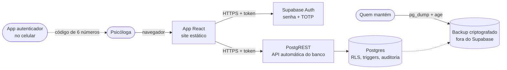
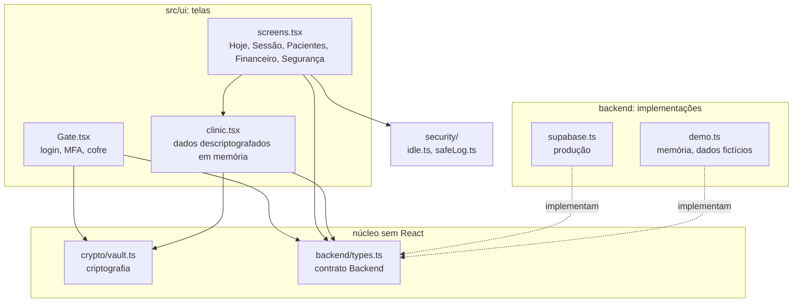
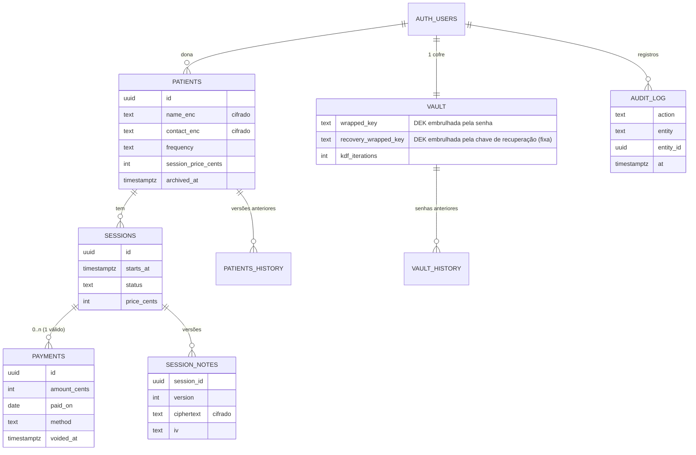
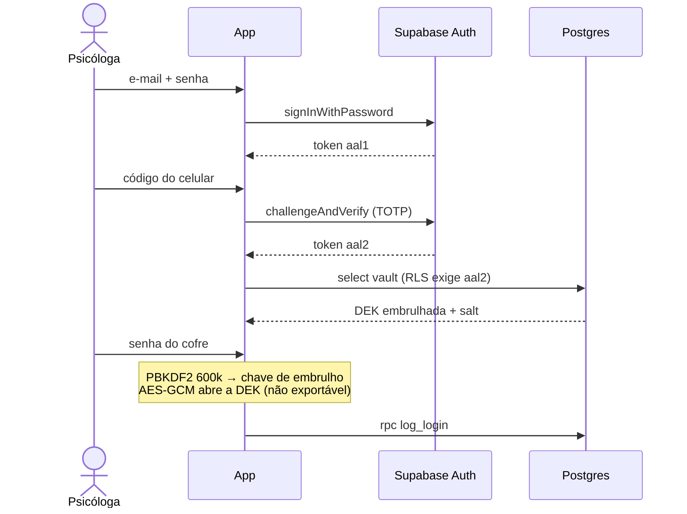
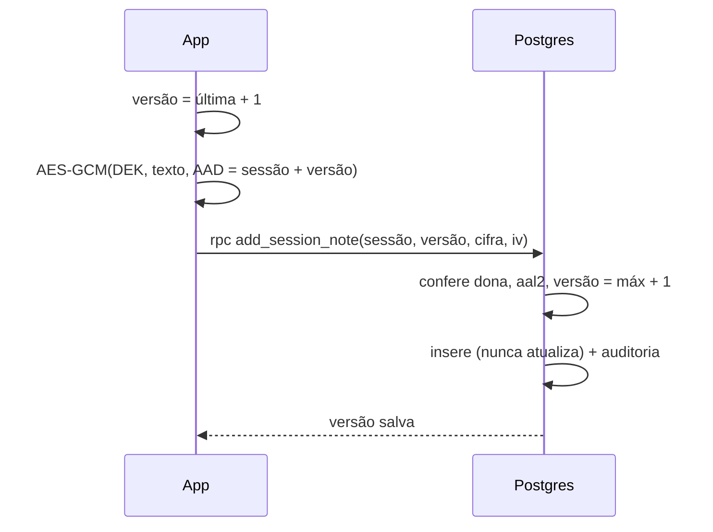
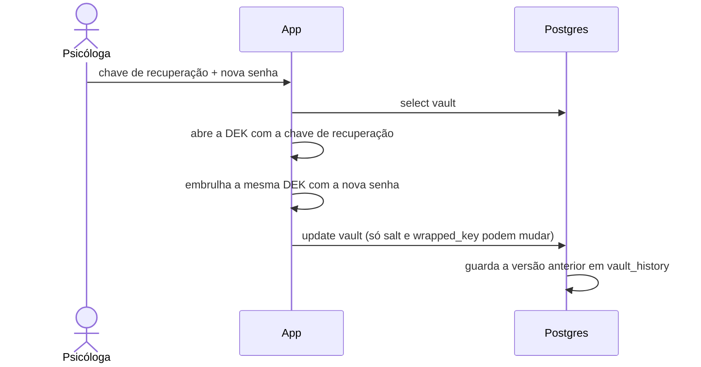

# Arquitetura

Visão de como as peças se conectam. Os porquês de cada escolha estão nos [registros de decisão](adr/).

## 1. Contexto

Uma única usuária, a psicóloga, usa o sistema num navegador. Não há servidor próprio: o app é um site estático, e os dados ficam num Postgres gerenciado pelo Supabase.

## 2. Camadas do código

Regras de dependência:

- **A tela nunca fala com o banco direto.** Fala com a interface `Backend` (`types.ts`). Isso permite trocar o servidor, ou rodar a demonstração, sem mexer em nenhuma tela.
- **`vault.ts` não depende de React nem do navegador além da Web Crypto.** Por isso roda nos testes com Node puro.
- **A segurança não depende do app.** Toda regra de acesso está no banco. Se o app tiver um erro, o banco ainda bloqueia.

## 3. Modelo de dados

Em claro no servidor ficam só datas, valores, status e quantidades. Nome, contato e anotação ficam cifrados. Detalhes em [SECURITY.md](../SECURITY.md#3-o-que-o-servidor-consegue-ver).

## 4. Fluxos principais

### Entrar e abrir o cofre

### Salvar uma anotação

Se outra aba salvou antes, o número de versão não bate e o banco recusa. A tela pede para recarregar, em vez de sobrescrever.

### Esquecer a senha do cofre

A chave de dados não muda, então nenhuma anotação precisa ser recriptografada.

## 5. Onde cada regra é garantida

| Regra | App | Banco | Teste |
|---|---|---|---|
| Só a dona acessa | — | RLS `dona_*` | `supabase/tests` |
| Exige código do celular | Fluxo de telas | RLS restritiva `mfa_*` | `supabase/tests` |
| Conteúdo ilegível no servidor | `vault.ts` | — | `tests/vault.test.ts` |
| Nada é apagado | Botões só arquivam/cancelam | Triggers de DELETE e TRUNCATE | `supabase/tests` |
| Anotação só ganha versões | Tela de versões | Sem UPDATE + trigger + RPC | ambos |
| Auditoria | Tela Segurança | Triggers + RPC de leitura | `supabase/tests` |
| Saída por inatividade | `idle.ts` | Tempo de sessão do Supabase (configuração) | `tests/e2e` |

## 6. Ambientes

| Ambiente | Como roda | Dados |
|---|---|---|
| Demonstração | `npm run dev:demo` ou build `build:demo` | Fictícios, em memória |
| Testes | `npm test` (Node + Postgres local) | Fictícios |
| Piloto | Supabase grátis + Cloudflare Pages | Fictícios |
| Produção | Supabase Pro + Cloudflare Pages | Reais, só depois da revisão de segurança |
